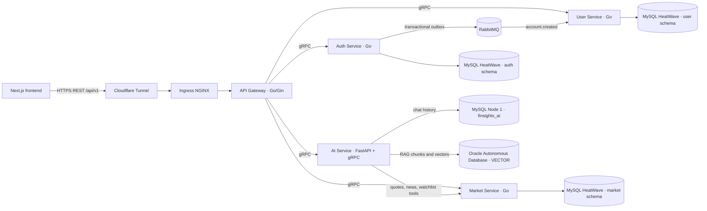

# Finsights Backend

Monorepo scaffold for the Finsights API. Go services use Gin at the public REST edge and gRPC between internal services. The AI process is Python/FastAPI and also exposes its internal gRPC contract. Services are separate binaries and containers.

## Architecture



The public path is Cloudflare Tunnel → Ingress NGINX → Go/Gin gateway. Ingress NGINX handles cluster ingress and host/TLS routing; the gateway is the single public API entry. Browsers use REST, while service-to-service calls use gRPC except AI session-history reads, which use internal FastAPI HTTP. The gateway centralizes CORS and JWT checks; a shared global rate limiter across all public routes can be added before launch. Core services are `ClusterIP` only. The gateway forwards the signed bearer token; services that require identity verify it again.

Auth owns credentials and sessions. Registration writes the account and an `account.created` outbox record in one MySQL transaction. A relay publishes that record to RabbitMQ. User consumes it idempotently to create the profile. This follows the event/outbox flow in [fiurozz-be](https://github.com/Fizzisme/fiurozz-be/tree/develop), with Go/gRPC contracts here. RabbitMQ is deployed by the platform repository.

The frontend currently uses mock market values, sample news, and browser-local watchlists/chat history. The authenticated AI REST API is wired through the gateway, but frontend chat integration and sign-in UI remain separate work. The AI service stores chat history in Node 1 `finsights_ai`, reads market/news data through MarketService, and can change a user's watchlist through UserService only after an explicit request. It uses an OpenAI-compatible API for final answers; DeepSeek Flash is the low-cost default, while GPT can be selected by changing the endpoint/model and secret.

AI harness code is separated under `services/ai/agent`, `llm`, `database`, and `rag`. The harness has a fixed tool allowlist, validates arguments, limits tool rounds/calls and response tokens, caps each user's requests at 10 per minute by default, and allows at most two concurrent turns per pod. It treats retrieved content as untrusted data and only exposes read-only financial tools plus explicit watchlist changes. It does not expose trade execution. Oracle Autonomous Database stores financial-news chunks and 1024-dimensional vectors; `python-oracledb` connects with the mounted Autonomous Database wallet. Voyage embeddings are optional and disabled until `AI_RAG_ENABLED=true` and its API key, wallet and Oracle credentials are present. The SQL setup is in `services/ai/sql/001_oracle_knowledge_chunks.sql`; a manual news indexer reads the existing MarketService catalog with `scripts/index_recent_news_to_oracle.py`.

The initial vector store uses exact cosine-distance scans to keep the thesis deployment small. Add an Oracle vector index only after measuring latency and corpus size. Reindexing skips unchanged article chunks using content hashes.

## Services and ports

| Process | Default port | Protocol | Responsibility |
| --- | ---: | --- | --- |
| `api-gateway` | 8080 | HTTP/REST | Public API, CORS/JWT verification, gRPC clients |
| `auth-service` | 9091 | gRPC | Registration, login, token issue, outbox relay |
| `user-service` | 9092 | gRPC | Profiles and watchlists; RabbitMQ account provisioning consumer |
| `market-service` | 9093 | gRPC | Stocks, quotes, candles, indices, financial news |
| `ai-service` | 8081 / 9094 | HTTP + gRPC | FastAPI health/docs surface and internal AI RPC |

## Database boundary

Connect each service to its own MySQL schema and least-privilege database user on the existing HeatWave system. DSNs and passwords are runtime secrets. Go services use the Node 2 CA through `MYSQL_TLS_CA_FILE`; AI history uses the separate Node 1 CA through `AI_MYSQL_TLS_CA_FILE`. Both require CA-chain verification. The current MySQL certificate identity does not match the public IP, so the Python connector defaults to chain verification with identity verification off in Helm; set `AI_MYSQL_TLS_VERIFY_IDENTITY=true` once the certificate identity matches the database hostname. The `finsights-coredb` repository owns creation of MySQL databases, tables, and app users.

AI chat history stays on Node 1 `finsights_ai`; it does not write transcripts to Oracle. Oracle Autonomous Database is reserved for RAG chunks, metadata and `VECTOR(1024,FLOAT32)` embeddings. Keep the Oracle wallet, database credentials, DeepSeek/OpenAI API key and optional Voyage key in Kubernetes Secrets. Do not put wallet contents or keys in Git.

The deployment configuration accepts endpoints and credentials through environment variables; it does not hard-code a MySQL password, JWT key, or broker credential. The K3s node currently reaches the public Node 2 MySQL endpoint on TCP 3306 for backend services and Node 1 for AI history. A private K3s-to-OCI route is not configured in the available infrastructure. The Oracle Terraform currently defines public MySQL NLB endpoints and allows port 3306 from `0.0.0.0/0`; restrict that source before production. The public API path is Cloudflare Tunnel → Ingress NGINX → Gateway. Ingress remains disabled until its hostname, TLS Secret, and Tunnel origin are configured.

## Local development

Requirements: Go 1.26+, `protoc`, Python 3.12+, and RabbitMQ. The managed MySQL database can be used after the schema migrations are supplied by the DB repository.

```sh
cd finsights/finsights-backend
make generate
go run ./cmd/auth-service
go run ./cmd/user-service
go run ./cmd/market-service
go run ./cmd/api-gateway
```

Run `python -m pip install -r services/ai/requirements.txt`, then `make generate-ai` and `uvicorn services.ai.app:app --host 0.0.0.0 --port 8081` for the AI process. FastAPI listens on 8081 and its internal gRPC server listens on `AI_GRPC_ADDR` (9094 by default). All services require their environment variables; see `.env.example`. RabbitMQ uses a durable topic exchange and a durable user provisioning queue with retry and dead-letter routing.

`make generate` downloads pinned Go protoc plugins into `.tools/bin` and creates Go stubs under `gen/go`. `make generate-ai` requires the Python dependencies in `services/ai/requirements.txt` and creates Python stubs under `services/ai/generated`. The expected table contract is in [docs/database-contract.md](docs/database-contract.md); database schemas are managed in `finsights-coredb`.

## CI/CD and K3s deployment

The `Build and deploy backend` GitHub Actions workflow builds five immutable `linux/amd64` images on pushes to `main`: the API gateway, auth, user, market, and AI services. It publishes each image to GHCR with the commit SHA, then updates `deploy/helm/values.yaml` to that same tag. The workflow uses the built-in `GITHUB_TOKEN`; it does not need an SSH key or database/API password. Argo CD polls this repository and rolls out the new image tag.

The Helm chart is in `deploy/helm`. `finsights-platform-deployment/applications/finsights-backend.yaml` registers it under the existing `root-platform-apps` Application. Workloads use small requests and limits for the two 8 GB nodes. Internal Go services and both AI ports are `ClusterIP` only. The gateway Ingress is disabled until the API hostname, TLS, and Cloudflare Tunnel origin are configured.

Before the first sync, create the Kubernetes Secret `finsights-backend-secrets` in namespace `finsights-platform` with these keys:

| Key | Used by | Value source |
| --- | --- | --- |
| `AUTH_MYSQL_DSN` | auth-service | MySQL Node 2 user `finsights_auth_app`, database `finsights_auth` |
| `USER_MYSQL_DSN` | user-service | MySQL Node 2 user `finsights_user_app`, database `finsights_user` |
| `MARKET_MYSQL_DSN` | market-service | MySQL Node 2 user `finsights_market_app`, database `finsights_market` |
| `JWT_SIGNING_KEY` | gateway, auth, user, ai-service | Random value of at least 32 bytes; use the same value for all four |
| `RABBITMQ_URL` | auth, user | `amqp://admin:<encoded-password>@rabbitmq.finsights-platform.svc.cluster.local:5672/` |
| `AI_MYSQL_PASSWORD` | ai-service | Node 1 app user `finsights_ai_app` |
| `AI_LLM_API_KEY` | ai-service | DeepSeek or OpenAI API key; use one provider |
| `AI_ORACLE_DSN` | ai-service | Autonomous Database wallet service alias from `tnsnames.ora` |
| `AI_ORACLE_USER` | ai-service | Least-privilege Oracle user owning the RAG table |
| `AI_ORACLE_PASSWORD` | ai-service | Password for that Oracle user |
| `AI_ORACLE_WALLET_PASSWORD` | ai-service | Wallet password if required by the downloaded wallet |
| `VOYAGE_API_KEY` | ai-service | Optional; used only when semantic RAG is enabled |

Create the `finsights-ai-oracle-wallet` Kubernetes Secret from the wallet files (`tnsnames.ora`, `ewallet.pem`, and any required network config). The AI deployment mounts it read-only. Apply `services/ai/sql/001_oracle_knowledge_chunks.sql` once to the Oracle schema before enabling RAG. Leave `AI_RAG_ENABLED=false` until that setup and Voyage credentials are ready. The MySQL CA certificates are public and mounted from Helm ConfigMaps; do not put the wallet or actual passwords in Helm values or GitHub Actions logs.

DeepSeek Flash is the default model. OpenAI GPT can be selected with `AI_LLM_BASE_URL=https://api.openai.com/v1`, its model name, and API key. Tune `AI_MAX_OUTPUT_TOKENS`, `AI_MAX_HISTORY_MESSAGES`, `AI_MAX_TOOL_ROUNDS`, `AI_MAX_TOOL_CALLS`, and `AI_MAX_REQUESTS_PER_MINUTE` to control usage. Defaults cap output at 700 tokens, include at most 12 recent messages, allow three tool rounds/five calls, and accept 10 requests per user per minute per pod. Requests above the configured per-pod concurrency limit receive a retryable response.

All five published GHCR packages are public, so K3s can pull them without a registry token or Kubernetes image pull Secret.

The frontend repository currently serves mock market/news data and browser-local watchlists; it does not call this API yet. After the internal deployment is healthy, configure the gateway Ingress and Tunnel origin, then point the frontend at the API and allow its origin through `CORS_ALLOWED_ORIGINS`.

## HTTP API (gateway)

| Method | Path | Auth | Purpose |
| --- | --- | --- | --- |
| `POST` | `/api/v1/auth/register` | No | Create account; profile provisioning continues asynchronously |
| `POST` | `/api/v1/auth/login` | No | Issue an access token |
| `GET` | `/api/v1/users/me` | Bearer token | Read profile |
| `PATCH` | `/api/v1/users/me` | Bearer token | Update display name |
| `GET` | `/api/v1/users/me/watchlist` | Bearer token | List watchlist symbols |
| `POST` | `/api/v1/users/me/watchlist` | Bearer token | Add symbol |
| `DELETE` | `/api/v1/users/me/watchlist/:symbol` | Bearer token | Remove symbol |
| `GET` | `/api/v1/stocks` | No | Search/filter instruments |
| `GET` | `/api/v1/stocks/:symbol` | No | Instrument and latest quote |
| `GET` | `/api/v1/stocks/:symbol/candles` | No | Historical candles |
| `GET` | `/api/v1/indices` | No | Market indices and latest values |
| `GET` | `/api/v1/news` | No | Financial news, optionally filtered by symbol/category |
| `GET` | `/api/v1/news/:slug` | No | Article detail |
| `POST` | `/api/v1/ai/chat` | Bearer token | Ask the AI service; account ID comes from the verified JWT |
| `GET` | `/api/v1/ai/sessions` | Bearer token | List the caller's chat sessions (`limit`, `offset`) |
| `GET` | `/api/v1/ai/sessions/:session_id/messages` | Bearer token | Read only messages belonging to the caller's session |
| `DELETE` | `/api/v1/ai/sessions/:session_id` | Bearer token | Close a session (soft delete) |

Health endpoints are `/livez` and `/readyz` on the gateway, `/healthz` and `/readyz` on FastAPI, and standard gRPC health checks for Go services.

Chat request body is `{"message":"Tóm tắt tin mới về SHB","session_id":null}` with a bearer token. Omit `session_id` to create a chat; send the returned UUID to continue it. The account ID is always taken from the verified token. The response includes the answer, session ID, detected symbols and article slugs; citations are included as links in the answer.

## Open decisions

- The frontend chatbot still uses localStorage and a mock response; connect it to the authenticated gateway endpoints after the login UI is available.
- The initial Oracle news indexer is a manual CLI. Schedule it after scraping and market-news ingestion settle, then add source deletion/update reconciliation.
- AI tools read current data through MarketService. Scraper ingestion into the MarketService catalog still needs to be connected and scheduled; the Oracle news indexer is a separate manual seed step for RAG.
- Add the DeepSeek API key to Kubernetes Secrets; switch endpoint/model and key only if you prefer OpenAI GPT.
- Create the Autonomous Database vector schema/user and wallet; semantic RAG remains disabled until then.
- The frontend has no login/register UI yet, and its watchlist/chat data is currently local-only.
- The MySQL private network/VPN route from K3s to OCI VCN must be provisioned and live-checked. The public API hostname, TLS Secret, and Cloudflare Tunnel origin configuration must be supplied before enabling the chart Ingress.
