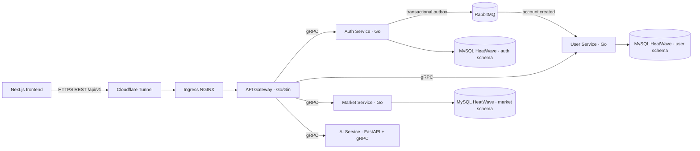

# Finsights Backend

Monorepo scaffold for the Finsights API. Go services use Gin at the public REST edge and gRPC between internal services. The AI process is Python/FastAPI and also exposes its internal gRPC contract. Services are separate binaries and containers.

## Architecture



The public path is Cloudflare Tunnel → Ingress NGINX → Go/Gin gateway. Ingress NGINX handles cluster ingress and host/TLS routing; the gateway is the single public API entry. Browsers use REST, while service-to-service calls stay on gRPC inside the cluster. The gateway centralizes CORS and JWT checks and is the right place to add a shared rate limiter before launch. Core services are `ClusterIP` only. The gateway forwards the signed bearer token; services that require identity verify it again.

Auth owns credentials and sessions. Registration writes the account and an `account.created` outbox record in one MySQL transaction. A relay publishes that record to RabbitMQ. User consumes it idempotently to create the profile. This follows the event/outbox flow in [fiurozz-be](https://github.com/Fizzisme/fiurozz-be/tree/develop), with Go/gRPC contracts here. RabbitMQ is deployed by the platform repository.

The frontend currently uses mock market values, sample news, and browser-local watchlists/chat history. The contracts cover those screens, but no market-data provider or ingestion worker is included. The AI service has no model provider configured and returns an explicit `UNIMPLEMENTED` response until one is selected.

## Services and ports

| Process | Default port | Protocol | Responsibility |
| --- | ---: | --- | --- |
| `api-gateway` | 8080 | HTTP/REST | Public API, CORS/JWT verification, gRPC clients |
| `auth-service` | 9091 | gRPC | Registration, login, token issue, outbox relay |
| `user-service` | 9092 | gRPC | Profiles and watchlists; RabbitMQ account provisioning consumer |
| `market-service` | 9093 | gRPC | Stocks, quotes, candles, indices, financial news |
| `ai-service` | 8081 / 9094 | HTTP + gRPC | FastAPI health/docs surface and internal AI RPC |

## Database boundary

Connect each Go service to its own MySQL schema and least-privilege database user on the existing HeatWave system. DSNs are runtime secrets. The app requires a trusted CA file via `MYSQL_TLS_CA_FILE`, verifies the server certificate, and uses TLS 1.2 or newer. If the endpoint is reached by IP, set `MYSQL_TLS_SERVER_NAME` to the database certificate's DNS name. The `finsights-coredb` repository owns creation of these databases, tables, columns, and app users.

The deployment configuration accepts endpoints and credentials through environment variables; it does not hard-code a MySQL password, JWT key, or broker credential. The K3s node currently reaches the public Node 1 MySQL endpoint on TCP 3306, and the service still verifies MySQL TLS with the CoreDB CA. A private K3s-to-OCI route is not configured in the available infrastructure. The Oracle Terraform currently defines public MySQL NLB endpoints and allows port 3306 from `0.0.0.0/0`; restrict that source before production. The public API path is Cloudflare Tunnel → Ingress NGINX → Gateway. Ingress remains disabled until its hostname, TLS Secret, and Tunnel origin are configured.

## Local development

Requirements: Go 1.26+, `protoc`, Python 3.12+, and RabbitMQ. The managed MySQL database can be used after the schema migrations are supplied by the DB repository.

```sh
cd finsights/finsights-backend
make generate
go run ./cmd/auth-service
go run ./cmd/user-service
go run ./cmd/market-service
go run ./cmd/api-gateway
```

Run `python -m pip install -r services/ai/requirements.txt`, then `make generate-ai` and `uvicorn services.ai.app:app --host 0.0.0.0 --port 8081` for the AI process. All services require their environment variables; see `.env.example`. RabbitMQ uses a durable topic exchange and a durable user provisioning queue with retry and dead-letter routing.

`make generate` downloads pinned Go protoc plugins into `.tools/bin` and creates Go stubs under `gen/go`. `make generate-ai` requires the Python dependencies in `services/ai/requirements.txt` and creates Python stubs under `services/ai/generated`. The expected table contract is in [docs/database-contract.md](docs/database-contract.md); database schemas are managed in `finsights-coredb`.

## CI/CD and K3s deployment

The `Build and deploy backend` GitHub Actions workflow builds five immutable `linux/amd64` images on pushes to `main`: the API gateway, auth, user, market, and AI services. It publishes each image to GHCR with the commit SHA, then updates `deploy/helm/values.yaml` to that same tag. The workflow uses the built-in `GITHUB_TOKEN`; it does not need an SSH key or database password. Argo CD polls this repository and rolls out the new image tag.

The Helm chart is in `deploy/helm`. `finsights-platform-deployment/applications/finsights-backend.yaml` registers it under the existing `root-platform-apps` Application. Workloads use small requests and limits for the two 8 GB nodes. Internal Go services and the AI gRPC port are `ClusterIP` only. The gateway Ingress is disabled until the API hostname, TLS, and Cloudflare Tunnel origin are configured.

Before the first sync, create the Kubernetes Secret `finsights-backend-secrets` in namespace `finsights-platform` with these keys:

| Key | Used by | Value source |
| --- | --- | --- |
| `AUTH_MYSQL_DSN` | auth-service | MySQL Node 1 user `finsights_auth_app`, database `finsights_auth` |
| `USER_MYSQL_DSN` | user-service | MySQL Node 1 user `finsights_user_app`, database `finsights_user` |
| `MARKET_MYSQL_DSN` | market-service | MySQL Node 1 user `finsights_market_app`, database `finsights_market` |
| `JWT_SIGNING_KEY` | gateway, auth, user | Random value of at least 32 bytes; use the same value for all three |
| `RABBITMQ_URL` | auth, user | `amqp://admin:<encoded-password>@rabbitmq.finsights-platform.svc.cluster.local:5672/` |

The DSNs must use TLS. The services enforce TLS 1.2+ and verify the MySQL certificate using the public Node 1 CA bundled in the chart; configure the certificate DNS name with `MYSQL_TLS_SERVER_NAME` if the database is reached through an IP address. Keep actual DSN passwords and the JWT key in the Kubernetes Secret only, never in Helm values or GitHub Actions logs.

All five published GHCR packages are public, so K3s can pull them without a registry token or Kubernetes image pull Secret.

The frontend repository currently serves mock market/news data and browser-local watchlists; it does not call this API yet. After the internal deployment is healthy, configure the gateway Ingress and Tunnel origin, then point the frontend at the API and allow its origin through `CORS_ALLOWED_ORIGINS`.

## HTTP API (gateway)

| Method | Path | Auth | Purpose |
| --- | --- | --- | --- |
| `POST` | `/api/v1/auth/register` | No | Create account; profile provisioning continues asynchronously |
| `POST` | `/api/v1/auth/login` | No | Issue an access token |
| `GET` | `/api/v1/users/me` | Bearer token | Read profile |
| `PATCH` | `/api/v1/users/me` | Bearer token | Update display name |
| `GET` | `/api/v1/users/me/watchlist` | Bearer token | List watchlist symbols |
| `POST` | `/api/v1/users/me/watchlist` | Bearer token | Add symbol |
| `DELETE` | `/api/v1/users/me/watchlist/:symbol` | Bearer token | Remove symbol |
| `GET` | `/api/v1/stocks` | No | Search/filter instruments |
| `GET` | `/api/v1/stocks/:symbol` | No | Instrument and latest quote |
| `GET` | `/api/v1/stocks/:symbol/candles` | No | Historical candles |
| `GET` | `/api/v1/indices` | No | Market indices and latest values |
| `GET` | `/api/v1/news` | No | Financial news, optionally filtered by symbol/category |
| `GET` | `/api/v1/news/:slug` | No | Article detail |
| `POST` | `/api/v1/ai/chat` | No for the current mock frontend | Ask the AI service; apply provider-specific abuse limits before launch |

Health endpoints are `/livez` and `/readyz` on the gateway, `/healthz` and `/readyz` on FastAPI, and standard gRPC health checks for Go services.

## Open decisions

- AI service database integration has not been implemented; the current AI service is an explicit stub and does not connect to the MySQL Node 2 schema.
- A market data/news source and ingestion cadence have not been selected.
- An AI model/provider, API credentials, and answer grounding policy have not been selected.
- The frontend has no login/register UI yet, and its watchlist/chat data is currently local-only.
- The MySQL private network/VPN route from K3s to OCI VCN must be provisioned and live-checked. The public API hostname, TLS Secret, and Cloudflare Tunnel origin configuration must be supplied before enabling the chart Ingress.
