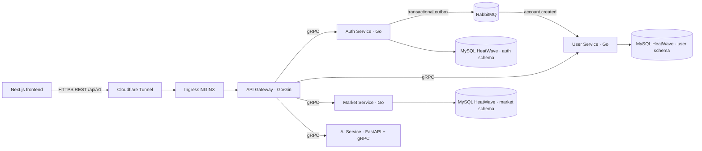

# Finsights Backend

Monorepo scaffold for the Finsights API. Go services use Gin at the public REST edge and gRPC between internal services. The AI process is Python/FastAPI and also exposes its internal gRPC contract. Services are separate binaries and containers.

## Architecture



The public path is Cloudflare Tunnel → Ingress NGINX → Go/Gin gateway. Ingress NGINX handles cluster ingress and host/TLS routing; the gateway is the single public API entry. Browsers use REST, while service-to-service calls stay on gRPC inside the cluster. The gateway centralizes CORS and JWT checks and is the right place to add a shared rate limiter before launch. Core services are `ClusterIP` only. The gateway forwards the signed bearer token; services that require identity verify it again.

Auth owns credentials and sessions. Registration writes the account and an `account.created` outbox record in one MySQL transaction. A relay publishes that record to RabbitMQ. User consumes it idempotently to create the profile. This follows the event/outbox flow in [fiurozz-be](https://github.com/Fizzisme/fiurozz-be/tree/develop), with Go/gRPC contracts here. The local infrastructure repositories do not currently deploy RabbitMQ.

The frontend currently uses mock market values, sample news, and browser-local watchlists/chat history. The contracts cover those screens, but no market-data provider or ingestion worker is included. The AI service has no model provider configured and returns an explicit `UNIMPLEMENTED` response until one is selected.

## Services and ports

| Process | Default port | Protocol | Responsibility |
| --- | ---: | --- | --- |
| `api-gateway` | 8080 | HTTP/REST | Public API, CORS/JWT verification, gRPC clients |
| `auth-service` | 9091 | gRPC | Registration, login, token issue, outbox relay |
| `user-service` | 9092 | gRPC | Profiles and watchlists; RabbitMQ account provisioning consumer |
| `market-service` | 9093 | gRPC | Stocks, quotes, candles, indices, financial news |
| `ai-service` | 8081 / 9094 | HTTP + gRPC | FastAPI health/docs surface and internal AI RPC |

## Database boundary

Connect each Go service to its own MySQL schema and least-privilege database user on the existing HeatWave system. DSNs are runtime secrets. The app requires a trusted CA file via `MYSQL_TLS_CA_FILE`, verifies the server certificate, and uses TLS 1.2 or newer. If the private endpoint is an IP rather than the certificate's DNS name, set `MYSQL_TLS_SERVER_NAME` to that certificate name. This repo intentionally does not contain SQL migrations: the infrastructure docs assign schema and migration ownership to `finsights-core-db`, which is not present in the workspace. Add the migrations there once that repository is available.

The deployment configuration accepts endpoints and credentials through environment variables; it does not hard-code a MySQL endpoint, password, JWT key, or broker credential. The selected production path is K3s → private network/VPN → MySQL HeatWave, with TLS certificate verification enabled. Repository review found only Tailscale between the two VPS nodes: the role accepts routes but does not advertise an OCI subnet, and the OCI Terraform has no VPN, DRG, peering, or route back to K3s. So the private database route is not configured in the code available here and still needs to be provisioned and checked on the live network. Separately, the Oracle Terraform defaults to creating a public MySQL NLB and its public subnet security list allows port 3306 from `0.0.0.0/0`; the deployment docs list those public endpoints as available. That is separate from the selected private path and needs review before production. The public API path is Cloudflare Tunnel → Ingress NGINX → Gateway. Ingress remains disabled until its hostname and TLS Secret are supplied.

## Local development

Requirements: Go 1.26+, `protoc`, Python 3.12+, and RabbitMQ. The managed MySQL database can be used after the schema migrations are supplied by the DB repository.

```sh
cd finsights/finsights-backend
make generate
go run ./cmd/auth-service
go run ./cmd/user-service
go run ./cmd/market-service
go run ./cmd/api-gateway
```

Run `python -m pip install -r services/ai/requirements.txt`, then `make generate-ai` and `uvicorn services.ai.app:app --host 0.0.0.0 --port 8081` for the AI process. All services require their environment variables; see `.env.example`. RabbitMQ uses a durable topic exchange and a durable user provisioning queue with retry and dead-letter routing.

`make generate` downloads pinned Go protoc plugins into `.tools/bin` and creates Go stubs under `gen/go`. `make generate-ai` requires the Python dependencies in `services/ai/requirements.txt` and creates Python stubs under `services/ai/generated`. The expected table contract is in [docs/database-contract.md](docs/database-contract.md); SQL migrations remain in the missing `finsights-core-db` repository.

## Container and K3s deployment

Build one Go image per service from this directory with `docker build -f Dockerfile.go --build-arg APP=api-gateway -t <registry>/finsights-api-gateway:<tag> .` (replace `APP` with `auth-service`, `user-service`, or `market-service`). Build AI with `docker build -f services/ai/Dockerfile -t <registry>/finsights-ai-service:<tag> .`.

The Helm chart lives in `finsights-platform-deployment/charts/finsights-backend`, matching the deployment boundary documented by the infrastructure repo. It creates internal `ClusterIP` Services, Deployments, a single-pod persistent RabbitMQ broker, and ingress-restricted NetworkPolicies. Ingress is disabled by default. Provide externally managed Secrets for database DSNs, JWT signing key, RabbitMQ connection URL, and RabbitMQ's initial username/password before installation. The dormant Argo CD Application template is in `deploy/argocd/application.yaml`; copy it into `finsights-platform-deployment/applications/` only after publishing images and creating the referenced Kubernetes Secrets. The current local backend folder is not yet a Git repository, so this scaffold does not apply resources to the live K3s cluster.

## HTTP API (gateway)

| Method | Path | Auth | Purpose |
| --- | --- | --- | --- |
| `POST` | `/api/v1/auth/register` | No | Create account; profile provisioning continues asynchronously |
| `POST` | `/api/v1/auth/login` | No | Issue an access token |
| `GET` | `/api/v1/users/me` | Bearer token | Read profile |
| `PATCH` | `/api/v1/users/me` | Bearer token | Update display name |
| `GET` | `/api/v1/users/me/watchlist` | Bearer token | List watchlist symbols |
| `POST` | `/api/v1/users/me/watchlist` | Bearer token | Add symbol |
| `DELETE` | `/api/v1/users/me/watchlist/:symbol` | Bearer token | Remove symbol |
| `GET` | `/api/v1/stocks` | No | Search/filter instruments |
| `GET` | `/api/v1/stocks/:symbol` | No | Instrument and latest quote |
| `GET` | `/api/v1/stocks/:symbol/candles` | No | Historical candles |
| `GET` | `/api/v1/indices` | No | Market indices and latest values |
| `GET` | `/api/v1/news` | No | Financial news, optionally filtered by symbol/category |
| `GET` | `/api/v1/news/:slug` | No | Article detail |
| `POST` | `/api/v1/ai/chat` | No for the current mock frontend | Ask the AI service; apply provider-specific abuse limits before launch |

Health endpoints are `/livez` and `/readyz` on the gateway, `/healthz` and `/readyz` on FastAPI, and standard gRPC health checks for Go services.

## Open decisions

- SQL schema/migration work is waiting for `finsights-core-db` as requested.
- A market data/news source and ingestion cadence have not been selected.
- An AI model/provider, API credentials, and answer grounding policy have not been selected.
- The frontend has no login/register UI yet, and its watchlist/chat data is currently local-only.
- The MySQL private network/VPN route from K3s to OCI VCN must be provisioned and live-checked. The public API hostname, TLS Secret, and Cloudflare Tunnel origin configuration must be supplied before enabling the chart Ingress.
